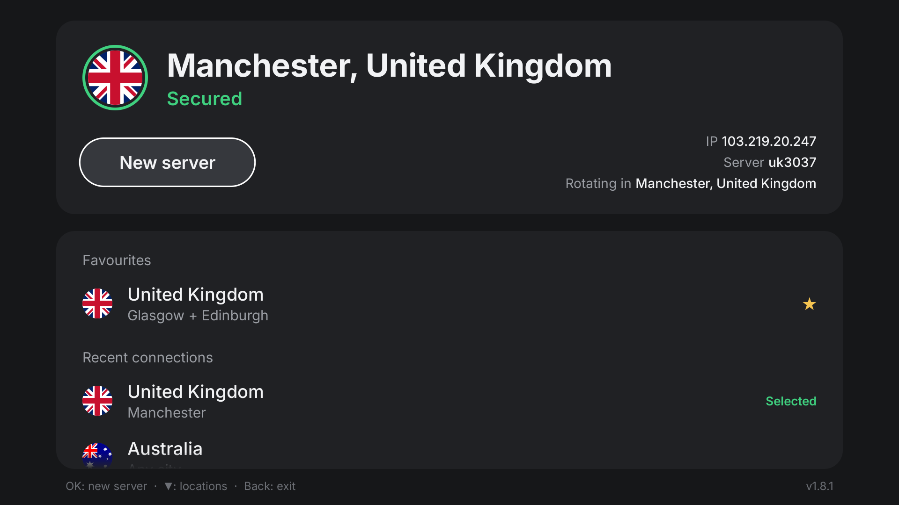

# nordvpn-webos

[](https://github.com/jonorl/NordVPN-WebOS/actions/workflows/shellcheck.yml)
[](https://github.com/jonorl/NordVPN-WebOS/actions/workflows/codeql.yml)

Route a rooted LG webOS TV (and only the TV) through NordVPN (NordLynx,
i.e. WireGuard) on an Asuswrt-Merlin router, and pick or rotate the server
from the TV with the remote.



```
 TV app "Rotate VPN"  --HTTP-->  router listener (socat, port 8099, TV only)
        |                              |
        |                              +--> /jffs/scripts/nord-rotate.sh
        |                                     asks NordVPN's API for a server,
        |                                     sets WireGuard client 1's endpoint
        |                                     and key, restarts the tunnel
        |
        +--> TV internet --> VPN Director rule --> WireGuard client 1 --> NordVPN
```

* Split tunnelling for one device: only the TV's traffic goes through
  NordVPN; every other device on the network uses the normal connection.
* Kill switch: the WireGuard client blocks the TV's internet while the
  tunnel is down, so nothing from the TV leaks outside the tunnel.
* NordLynx uses one private key per account and the same tunnel address for
  everyone, so switching server (in any country) only changes the endpoint
  and the server's public key.

Tested on: LG C1 (webOS 6, rooted, Homebrew Channel), RT-AX86U Pro with
Asuswrt-Merlin 3006.102.7.

> Why WireGuard: this setup first used OpenVPN, but NordVPN's OpenVPN UDP
> servers only listen on port 53, and some ISPs throttle or drop UDP 53 (the
> DNS port), especially in the evening: 60-second connection stalls and
> constant reconnects. NordLynx uses UDP 51820, like NordVPN's own apps.

## Repository layout

| Path | What it is |
| --- | --- |
| `app/` | The webOS app (plain HTML/JS; `index.html` is the whole app) |
| `router/nord-rotate.sh` | Picks a NordVPN server and switches WireGuard client 1 to it |
| `router/rotate-http.sh` | HTTP handler run by `socat` for the TV app |
| `router/nord-api.sh` | Fetches from NordVPN's API without depending on DNS |
| `router/nord-watchdog.sh` | Switches server when the current one stops answering |
| `router/install.sh` | Copies the scripts to the router and starts everything |
| `tools/nordlynx-key.sh` | Fetches your NordLynx private key and stores it on the router |
| `tools/install-app.sh` | Builds the app and installs it on the TV |
| `tools/nord-probe.py` | Lists NordVPN's country and city ids |

## Requirements

* A rooted LG webOS TV with the **Homebrew Channel** and its SSH server enabled.
* An Asus router running **Asuswrt-Merlin** (3006 series, which has a
  WireGuard client).
* A NordVPN subscription.
* On your PC: `ssh`, `curl`, and to build the app, Node.js plus LG's CLI:
  `sudo pacman -S nodejs npm && npm install -g @webos-tools/cli`
  (put npm's global prefix in your home folder first if you prefer,
  `npm config set prefix ~/.local`).

The examples below use these addresses; change them to yours:

| | |
| --- | --- |
| Router | `192.168.50.1`, login `admin` |
| TV | `192.168.50.215` |

---

## 1. Give the TV a fixed IP

**LAN → DHCP Server → Manual Assignment**: set *Enable Manual Assignment*
to **Yes**, add the TV's MAC address (wifi: `wlan0`, wired: `eth0`; find it
with `ssh root@TV 'cat /sys/class/net/wlan0/address'`) with IP
`192.168.50.215` and optionally host name `lgtv`, click **+**, then **Apply**.

Both the VPN Director rule and the listener's access restriction depend on
this IP.

## 2. Install the router scripts

**Administration → System**: set *Enable JFFS custom scripts and configs*
to **Yes** and *Enable SSH* to **LAN only**, then **Apply**. While there, set
the **NTP servers to IP addresses** (e.g. `162.159.200.1` and
`216.239.35.0`): after a reboot the router's clock is wrong until it syncs,
and if DNS is having a bad day it can't look up NTP server names.

From this repo on your PC:

```sh
./router/install.sh admin@192.168.50.1 192.168.50.215
```

This copies the scripts to `/jffs/scripts/` (and flushes them to flash, so a
reboot straight afterwards doesn't leave empty files), adds the listener, the
watchdog and a cron job that restarts the watchdog if it dies to
`/jffs/scripts/services-start` (run at every boot), and starts them. Run it
again after changing anything in `router/`.

The listener is
`socat TCP-LISTEN:8099,bind=192.168.50.1,…,range=192.168.50.215/32`:
`bind=` keeps it off the internet side; `range=` accepts connections from the
TV only.

## 3. Set up the NordLynx (WireGuard) client

1. Get an access token: Nord Account → **NordVPN → Set up NordVPN manually →
   Generate new token**.
2. Store your NordLynx private key on the router (asks for the token; prints
   neither):

   ```sh
   ./tools/nordlynx-key.sh admin@192.168.50.1
   ```

3. Pick the first server. This fills in and enables WireGuard client 1
   (address `10.5.0.2/32`, DNS `103.86.96.100`, server public key, endpoint
   port 51820, keepalive 25 s, kill switch on), so **don't fill in the
   WireGuard page yourself**:

   ```sh
   ssh admin@192.168.50.1 /jffs/scripts/nord-rotate.sh
   ```

   It prints e.g. `-> uk2468.nordvpn.com`. Reload **VPN → VPN Client →
   WireGuard → Client 1**: the fields are filled in and the status log shows
   a *latest handshake*. Always reload that page before clicking Apply on it:
   it saves the server that was showing when the page loaded.

   That page also shows your private key in full; anyone with it can use
   your NordVPN account, so don't share screenshots of it.
4. **VPN → VPN Director → Add new rule** (or, on the WireGuard client page,
   *VPN Director rules related to this client → click here*):

   | Enable | Description | Local IP | Remote IP | Iface |
   | --- | --- | --- | --- | --- |
   | ✓ | LG TV | `192.168.50.215` | *(empty)* | WGC1 |

   Click **OK**, then **Apply**.
5. Check from your PC (the first should print your VPN country, the second
   your real one):

   ```sh
   ssh root@192.168.50.215 'curl -s https://ipinfo.io/country'
   curl -s https://ipinfo.io/country
   ```

Test the listener:

```sh
ssh root@192.168.50.215 'curl -s http://192.168.50.1:8099/status'   # e.g. "uk2794.nordvpn.com state=2 phase=connected secs=310"
curl -s --max-time 5 http://192.168.50.1:8099/status || echo refused # from the PC: refused
```

Router endpoints (all `GET`, TV only):

| Endpoint | Does |
| --- | --- |
| `/rotate` | New server in the default cities (Glasgow + Edinburgh) |
| `/rotate?city=ID[,ID…]` | New server in one of these cities |
| `/rotate?country=ID` | New server anywhere in this country |
| `/cancel` | Back to the server before the last `/rotate` |
| `/countries[?refresh=1]` | NordVPN's country and city list (cached until reboot) |
| `/status` | Current server, `state=2` when connected, and the watchdog's `phase=… secs=…` |

Server lists (IP, hostname, public key) are saved per location in
`/jffs/scripts/nord-cache/` and reused for 30 minutes, so most rotations
don't contact NordVPN at all. If NordVPN's API can't be reached, the last
saved list is used instead. The router connects to the last address
`api.nordvpn.com` answered on (saved in `/jffs/scripts/nord-api-ip`) and only
looks the name up, over DNS-over-HTTPS and then plain DNS, when that fails,
so a throttled port 53 doesn't break rotations.

### The watchdog

A healthy NordLynx handshake takes about a second, but WireGuard retries a
server that doesn't answer forever, leaving the TV offline. `nord-watchdog.sh`
checks the last handshake every 3 s and, if there's been none for 30 s since
the last switch (or for 200 s on an established tunnel), switches to another
server in the last location used (at most once every 2 minutes) and skips
the failed server for 30 minutes.

It logs to syslog as `nord-watchdog`. Settings are at the top of the script.

You can also rotate by hand on the router:
`/jffs/scripts/nord-rotate.sh`, `… city 2978888`, or `… country 227`.

### Coming from the OpenVPN version

1. Rerun `router/install.sh` (it also removes the iptables kill switch an
   earlier version added).
2. Do step 3 above.
3. **VPN → VPN Client → OpenVPN → Client 1**: *Enable* **No**, then Apply.
4. In VPN Director, delete the old `LG TV` rule (iface OVPN1) and add the
   WGC1 one from step 3.4.

## 4. Install the app on the TV

```sh
./tools/install-app.sh root@192.168.50.215
```

Or by hand: `ares-package app`, then copy the `.ipk` to the TV and run

```sh
luna-send -i 'luna://com.webos.appInstallService/dev/install' \
  '{"id":"com.ares.defaultName","ipkUrl":"/tmp/nordrotate.ipk","subscribe":true}'
```

and press Ctrl+C after `"state":"installed"`. ares-package warns about
`requiredACG`; that only matters for LG's store, so leave it out.

### Using it

* **New server**: switch to another server in the selected location.
* **▼** moves into the list: *Favourites*, *Recent connections*, *Countries*.
* While connecting the button becomes **Cancel** (**OK** or **Back**). If the
  TV was online before, it goes back to the previous server; otherwise it
  stops waiting. Picking another location while connecting replaces the
  attempt.
* **OK** connects; on a country, **OK** or **▶** opens its cities and **◀**
  goes back. **Hold OK** toggles ★ favourite. **CH ±** pages.
* Before each switch it closes Disney+, iPlayer, Netflix and Prime Video
  (through the Homebrew Channel) so none keeps a connection open from the
  previous server.
* The status card turns amber while connecting (showing the router's
  progress) and green once the new IP is confirmed in the expected country.
* If a switch fails (e.g. NordVPN's API can't be reached for a location
  that has no saved list yet), the router keeps its current server and the
  card says **Still secured on uk…** next to the error.

### Settings in `app/index.html`

| Line / setting | Default |
| --- | --- |
| `ROUTER` | `http://192.168.50.1:8099` |
| `DEFAULT_LOC` | Glasgow + Edinburgh (first run only; your choices are saved on the TV) |
| `CLOSE_CMD` pattern | `disney|bbc|iplayer|netflix|^amazon$` |
| `WAIT_MS` / `LONG_PRESS_MS` | 90 s / 0.8 s |

After changing anything, bump `version` in `app/appinfo.json` (and the
`v…` label in `index.html`) and reinstall.

Router-side settings are at the top of `router/nord-rotate.sh`: `CLIENT`
(WireGuard client slot, default 1; also set in `nord-watchdog.sh`) and the
default city ids. Find ids with
`python3 tools/nord-probe.py` (UK: country 227; Glasgow 2978888,
Edinburgh 2975852, Manchester 2991110, London 2989907).

---

## Troubleshooting

Router-side state and log:

```sh
ssh admin@192.168.50.1 'wg show wgc1 | grep -v "private key"; cat /tmp/nord-phase; grep nord- /tmp/syslog.log | tail'
```

`/tmp/nord-phase` is the watchdog's view (`connected`, `connecting` or
`down`, and seconds since the last switch); the log shows every switch and
why.

| Symptom | Cause / fix |
| --- | --- |
| App says "offline" | Tunnel down; the kill switch blocks the TV. Press **New server**. |
| Stuck on "Contacting server…" | No WireGuard handshake: `ssh admin@192.168.50.1 'wg show wgc1'`. If *latest handshake* never appears on any server, check the private key (rerun `tools/nordlynx-key.sh`). Check the watchdog is running: `cat /tmp/nord-watchdog.pid; cat /tmp/nord-phase`. |
| `No NordLynx private key on the router yet` | Run `tools/nordlynx-key.sh` (step 3.2). |
| Router won't connect after a reboot | Clock not synced (`nvram get ntp_ready` is `0`). Use NTP server IPs (step 2). |
| `Couldn't reach the router` | Listener not running: `ssh admin@192.168.50.1 'pidof socat'`; rerun `router/install.sh`. |
| `No servers available: NordVPN unreachable and no saved list yet` | The router couldn't reach NordVPN's API and has never fetched this location before. Try again; once a location has been fetched, its saved list is used as a fallback. Also check the city/country id. |
| Empty files in `/jffs/scripts/` | The router rebooted before they were written to flash. Rerun `router/install.sh`. |
| TV not in the VPN country | Check the VPN Director rule and that the TV still has its reserved IP. |
| Streaming app still blocked | Most NordVPN IPs are known to the big services; rotating helps sometimes. Fully close the app (the app does this for you) before retrying. |

## Licences

Flags in `app/flags/` are from [flag-icons](https://github.com/lipis/flag-icons)
(MIT); the Inter font in `app/fonts/` is under the SIL Open Font License.
Both licence files are included. This project isn't affiliated with NordVPN
or LG.
